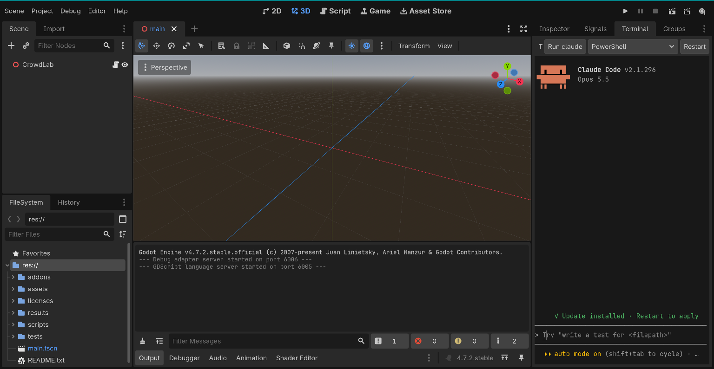
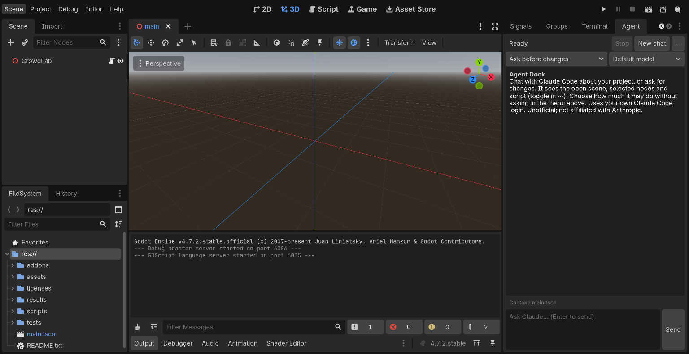

# Godot Agent Add-ons

Two Godot 4 editor add-ons for working with [Claude Code](https://claude.com/claude-code) without leaving the Godot editor.

> Unofficial community project. Not affiliated with, endorsed by, or supported by Anthropic. Claude and Claude Code are trademarks of Anthropic. Both add-ons run the official, unmodified Claude Code with each user's own login and never touch credentials.

| Add-on | What it is | Platform |
|---|---|---|
| [**Agent Terminal**](addons/agent_terminal) | A real terminal in the bottom panel that opens **in your project folder**. Type `claude` and you get the full Claude Code, exactly as in Windows Terminal. Also a normal PowerShell / Command Prompt. | Windows 10 1809+ / 11 |
| [**Agent Dock**](addons/agent_dock) | A chat panel next to the Inspector. Sends your open scene, selected nodes and script as context, and shows Allow / Deny cards with edit previews. | Windows, macOS, Linux |





Use either one or both. Both need Godot **4.4+** (tested on 4.7.2).

## Install

1. Install [Claude Code](https://claude.com/claude-code) and log in once from a terminal: `claude auth login`
2. Copy the add-on folder(s) you want from `addons/` into your project's `addons/` folder:
   - `addons/agent_terminal` gives you the Terminal tab
   - `addons/agent_dock` gives you the Agent chat dock
3. In Godot: **Project → Project Settings → Plugins**, enable **Agent Terminal** and/or **Agent Dock**.

Want to try them first? This repo is itself a small Godot project: open the folder in Godot and both add-ons are already enabled.

Optional: [godot-mcp](https://github.com/raising-heart/godot-mcp) gives Claude Godot tools (check scripts, run the game, take screenshots) in either add-on.

## Agent Terminal

- PowerShell, PowerShell 7 or Command Prompt, starting in the project folder
- Colours, full-screen apps, wide characters (CJK, emoji), scrollback
- Copy (select, then Ctrl+C), paste (Ctrl+V), right-click menu, mouse-wheel scrollback
- **Run claude** button, **Restart** button

Godot can't create a real console by itself, so the add-on includes a small helper, [`pty_host.cs`](addons/agent_terminal/pty_host.cs) (about 300 lines of C#), that uses the Windows pseudo console API. **The repo contains no prebuilt programs**: the helper is compiled on your computer, on first use, by the C# compiler that ships with Windows. The helper uses no network, and closing Godot ends the shell and everything in it. Details: [addons/agent_terminal/README.md](addons/agent_terminal/README.md).

## Agent Dock

- Context from the editor: open scene, selected nodes, current script and line
- Modes: *Ask before changes*, *Auto-accept file edits*, *Plan only*
- Allow / Allow for this chat / Deny, with before/after previews
- Saves scenes before sending, then reloads what changed

It runs Claude Code's documented headless mode (`claude -p` with stream-json) in your project folder. Details: [addons/agent_dock/README.md](addons/agent_dock/README.md).

## Tests

```bash
godot --headless --path . --script tests/terminal_buffer_test.gd
```

Checks the terminal's screen model: wrapping, clearing, scroll regions, the alternate screen, wide characters, UTF-8 split across chunks, colours and resizing.

## License

[MIT](LICENSE)
